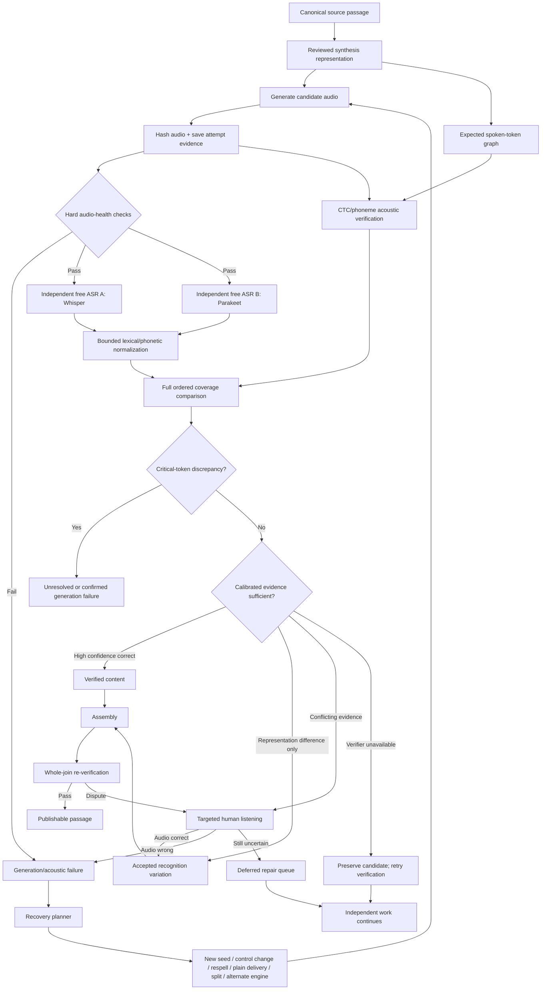
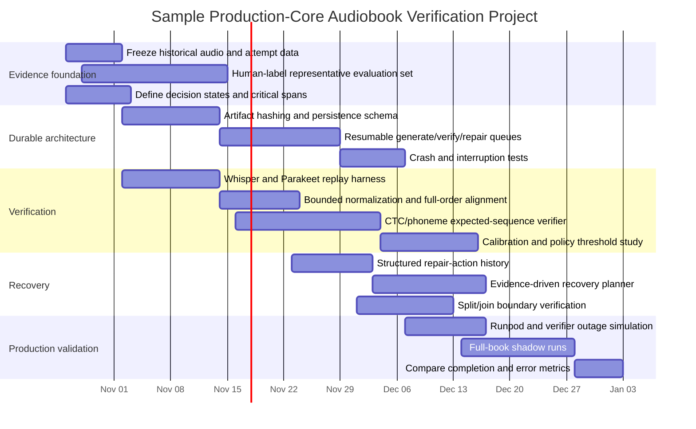

# Reliable Solution Selection and Recovery Architecture for an Initially Unspecified Task

## Executive summary

The request asks for a framework that assumes the task is unspecified, but the attached material actually defines a demanding concrete problem: **build a resumable audiobook-generation system that verifies the complete intended spoken passage in order, distinguishes synthesis defects from recognition mistakes, and recovers difficult recordings without sacrificing book completion**. It explicitly treats rejection as an intermediate diagnosis rather than a satisfactory terminal outcome, requires durable state across interruptions and verification outages, and prioritizes correct completed books over isolated clip-level acceptance accuracy. fileciteturn0file0

Accordingly, this report does both things: it first supplies the requested generic category-selection framework, then applies it to the available task. For this audiobook problem, the strongest fit is a combination of **software/reliability engineering, data/ML, and business-process orchestration**, with research/evaluation and operator-product design as supporting categories. Hardware is an implementation constraint rather than the central problem, and policy/compliance is important mainly for voice-cloning consent, licensing, retention, and provenance.

The recommended technical direction is **not another increasingly permissive text-matching rule and not a larger ensemble of text-only judges**. It is an evidence-fusion system with four independent layers:

1. deterministic audio-health checks;
2. at least two architecturally different, **unprompted** recognizers;
3. an expected-text-conditioned acoustic verifier that checks ordered, full coverage but cannot by itself prove correctness;
4. calibrated abstention and targeted human listening when the acoustic evidence remains ambiguous.

Whisper and NVIDIA Parakeet provide usefully different recognition architectures; Parakeet exposes word/character timestamps and configurable confidence/alignment information, while Whisper is an encoder-decoder system trained on 680,000 hours of weakly supervised speech. citeturn1academia38turn1search0 Forced-alignment systems such as Montreal Forced Aligner and CTC alignment are useful for locating whether the expected sequence has acoustic support, but forced alignment should **not be treated as proof** that the words were actually spoken: by construction it tries to fit supplied text to audio. citeturn2search0turn2search14

The highest-value architectural change is to make verification **tri-state or multi-state rather than binary**. The core states should be:

| State | Meaning | Required next action |
|---|---|---|
| **Verified content** | Evidence supports complete intended speech in order | Accept and retain evidence |
| **Accepted recognition variation** | Acoustic evidence supports the speech; transcript differences are representation-level | Accept, record variation and policy |
| **Unresolved uncertainty** | TTS-vs-ASR responsibility cannot be established | Reverify or human-listen; do not regenerate blindly |
| **Generation failure** | Evidence establishes wrong/missing/extra/repeated/reordered/unusable speech | Generate a meaningfully changed repair |
| **Verification unavailable** | Required recognizer/service/resource failed | Preserve candidate and retry verification later |
| **Acoustic failure** | Silence, excessive stalls, clipping, unusable level, corruption | Regenerate or repair audio; text judges cannot override |

This distinction directly addresses the central problem in the supplied specification: an ASR mismatch is evidence of disagreement, **not evidence that synthesis failed**. fileciteturn0file0

For the concrete implementation, my recommended priority order is:

**First: build the human-labelled replay benchmark and explicit decision policy before adding more models.** NIST's SCTK provides standard global alignment and even weighted-word scoring, which is relevant because numbers, negation and other critical words can be given greater consequence than ordinary orthographic mismatches. citeturn6search0turn6search1

**Second: separate the free-recognition path from the expected-text acoustic-verification path.** Use Whisper plus Parakeet for independent transcription evidence, then use CTC/phoneme alignment as a conditional acoustic check. Never let a forced aligner or text-only LLM override an observed omission, addition, reorder or hard acoustic defect.

**Third: make recovery durable and asynchronous.** Synthesis workers should continue generating independent passages while disputed clips enter a verification/repair queue. Candidate recordings should be content-addressed and checkpointed before any potentially catastrophic interruption. Runpod explicitly recommends network volumes when data must survive Pod termination or rescheduling because they decouple persistent data from the original GPU host. citeturn8search0 For a local CLI, SQLite plus content-addressed audio is sufficient initially; for a distributed deployment, a durable workflow engine such as Temporal is a reasonable later step because its event history reconstructs workflow state after worker crashes. citeturn4search2turn4search13

Fish Audio's current Drama 3 release makes this especially relevant. Fish describes Drama 3 as preview software whose results can vary between takes; its current open-weight installation documentation calls for an NVIDIA GPU with at least 48 GB of VRAM for Drama 3, while Apple's supported PyTorch MPS backend provides a practical route for running compatible verification workloads on Apple silicon. citeturn0search0turn0search17turn0search5

A realistic planning envelope for the audiobook system is:

| Scope | Planning estimate | External-development planning envelope* | Outcome |
|---|---:|---:|---|
| Proof of concept | 3–5 weeks | $15k–$40k | Replay benchmark, explicit states, dual ASR, durable candidates |
| Production-quality core | 8–12 weeks | $60k–$140k | Calibrated verifier, recovery planner, remote workers, interruption tests |
| High-rigor production system | 4–6 months | $180k–$400k+ | Multi-engine recovery, operator UI, extensive evaluation, observability/compliance |

\*Analytical budgeting estimates rather than vendor quotations; they assume paid engineering rather than existing staff. GPU operating cost is comparatively small for many verification experiments: as of October 8, 2026, Runpod lists Secure Cloud RTX A6000/A40-class 48 GB Pods around $0.59/hour, A100 80 GB around $1.79/hour, and corresponding serverless tiers around $1.22/hour and $2.72/hour. citeturn5search1


## Task-category landscape

For a genuinely unspecified task, the correct first move is not to choose technology but to identify what kind of uncertainty dominates. The categories below cover the major solution families requested. The final column shows their relevance to the attached audiobook task.

### Category comparison

| Category | Typical approaches | Core skills | Typical deliverables | Low / medium / high timeframe | Rough cost envelope† | Main risks | Representative success metrics | Fit to attached task |
|---|---|---|---|---|---|---|---|---|
| **Software development / reliability** | Prototype; modular service; durable workflow/state machine | Python/Rust/TS, APIs, databases, distributed systems, testing | CLI/service, state model, retry system, artifact store, tests | 1–3 wk / 1–3 mo / 3–9 mo | $5–20k / $30–120k / $150–500k+ | hidden state, duplicate work, non-idempotent retries, outages | completion rate, crash recovery, defect escape rate, throughput | **Very high** |
| **Data analysis / ML** | Rules/statistics; pretrained models; calibrated ensemble | statistics, ML, signal processing, experiment design | model pipeline, labelled dataset, benchmark, thresholds | 2–4 wk / 2–4 mo / 4–12 mo | $10–30k / $50–175k / $200–750k+ | leakage, calibration failure, biased evaluation, false confidence | precision/recall, false accept/reject, calibration, cost/unit | **Very high** |
| **Business process / operations** | SOP redesign; queues/SLA; automation/escalation | process mapping, operations, analytics | SOPs, state taxonomy, escalation rules, dashboards | days–2 wk / 1–2 mo / 3–6 mo | $2–10k / $15–75k / $100–300k | local optimization, bottlenecks, unclear ownership | cycle time, intervention rate, backlog age, completion | **High** |
| **Hardware / IoT / infrastructure** | Local appliance; cloud pool; hybrid compute | Linux/macOS, GPU systems, networking, deployment | images, workers, provisioning, monitoring | 1–3 wk / 1–3 mo / 3–9 mo | $3–20k / $25–100k / $125–500k | capacity shortage, hardware variance, persistence failures | utilization, availability, $/job, verified-seconds/sec | **Medium** |
| **Research / literature review** | Evidence review; benchmark reproduction; ablation study | literature search, experimental design, statistics | review, evidence matrix, prototype results, recommendations | 1–3 wk / 1–3 mo / 3–9 mo | $5–20k / $25–100k / $100–400k | obsolete results, incomparable benchmarks, publication bias | reproduced results, uncertainty reduction, decision usefulness | **High** |
| **Policy / regulatory / compliance** | Gap assessment; controls; auditable workflow | privacy, IP/licensing, security, governance | control matrix, consent records, retention/provenance design | 1–3 wk / 1–3 mo / 3–9 mo | $5–25k / $30–150k / $150–600k+ | jurisdiction gaps, consent issues, over-retention | audit pass rate, traceability, incidents, exceptions | **Medium** |
| **Project / program management** | Agile iteration; stage-gated program; risk-based roadmap | planning, dependency management, metrics | roadmap, milestones, risk register, release criteria | continuous | $5–20k / $20–100k / $100–400k+ | optimizing schedule over outcome, scope creep | milestones plus outcome KPIs, escaped risk, delivery predictability | **High** |
| **Product / UX design** | Operator workflow; review UI; authoring/preflight tools | UX research, interaction design, frontend | review console, diagnostics, preparation tools | 2–4 wk / 1–3 mo / 3–6 mo | $8–30k / $30–125k / $125–350k | UI hides uncertainty, human overload | review time, operator error, resolution rate, adoption | **Medium–high** |

†Planning envelopes are estimates for an unspecified commercial project and deliberately broad; infrastructure, licensing and regulatory costs can change them substantially.

The audiobook task is therefore not a pure "ML accuracy" problem. Its success criterion is closer to **dependable workflow completion under uncertain observations**, with ML serving as evidence inside that workflow. The attachment itself stresses completion, recovery, durable state and continuing independent work during disputes, which makes reliability engineering at least as important as recognition quality. fileciteturn0file0


## Solution approaches and prioritized recommendations by category

### Software development and reliability engineering

| Priority | Concrete approach | Skills | Deliverable | Time / cost estimate | Key risk | Success metric | Immediate next action |
|---|---|---|---|---|---|---|---|
| **Top** | **Explicit durable state machine + content-addressed artifacts** | Python/Rust, SQLite/Postgres, hashing, transactions | passage/attempt state schema; append-only evidence; resumable CLI | 3–6 wk / $20–60k | incomplete transitions create silent loss | 100% restart recovery in fault-injection tests; zero accepted artifacts without evidence | Define state-transition table and immutable artifact IDs |
| **Second** | **Decoupled synthesis, verification and repair queues** | concurrency, workers, backpressure, distributed systems | separate worker pools and bounded queues | 3–8 wk / $25–80k | unbounded backlog or duplicated generation | synthesis utilization, verifier latency, no duplicate billed work | Split current pipeline into `generate`, `verify`, `repair` jobs |
| **Third** | **Engine-neutral adapter architecture** | APIs, schemas, plugin design | Fish/alternate-engine/verifier adapters behind common contracts | 2–6 wk / $15–60k | lowest-common-denominator API loses engine controls | percent of pipeline shared across engines; repair portability | Freeze a versioned `GenerationAttempt` schema |

For this task, the first approach dominates because retries and sophisticated verification are worthless if process termination destroys evidence. Temporal demonstrates the mature form of this pattern: durable event history allows another worker to reconstruct state after a crash, and parallel execution is a first-class pattern. citeturn4search1turn4search2 A lighter CLI can implement the same principles with SQLite and immutable files before adopting a distributed workflow platform.

If SQLite is used with WAL mode, pin a current patched release: SQLite's own documentation records a rare WAL-reset corruption bug affecting releases through 3.51.2, fixed in 3.51.3 on March 13, 2026. citeturn4search6

### Data analysis and machine learning

| Priority | Concrete approach | Skills | Deliverable | Time / cost estimate | Key risk | Success metric | Immediate next action |
|---|---|---|---|---|---|---|---|
| **Top** | **Calibrated multi-evidence verifier** | ASR, statistics, calibration, speech processing | risk-scored verifier combining free ASR, acoustic alignment and QC | 5–10 wk / $35–100k | correlated models masquerade as independent evidence | false-accept rate at fixed coverage; ECE/Brier-style calibration; avoidable regenerations | Build a labelled replay dataset before threshold tuning |
| **Second** | **Expected-sequence CTC/phoneme acoustic scoring** | CTC, G2P, forced alignment, DP/FST | ordered coverage and acoustic support scores | 4–8 wk / $30–90k | forced alignment can fit wrong text | error detection on controlled omissions/additions/reorders | Prototype expected-vs-alternative acoustic score margin |
| **Third** | **Active-learning / human-dispute loop** | annotation design, statistics | review queue and periodically recalibrated model | 3–8 wk / $20–75k | labels drift toward only hard cases | reduction in unresolved rate without increased false acceptance | Label the first 300–500 saved disputed clips |

Parakeet exposes timestamps for CTC, RNNT and TDT decoders and NeMo exposes confidence/custom decoding facilities, making it practical as a second acoustic observation rather than another copy of Whisper. citeturn1search0turn1search1 Whisper, meanwhile, was trained with a different encoder-decoder approach on large-scale weak supervision, so disagreement between the two is more informative than rerunning the same deterministic recognizer repeatedly. citeturn1academia38

NIST SCTK is particularly relevant to the task's criticism of blanket WER thresholds: SCTK explicitly supports weighted-word alignment/scoring rather than assuming every word has equal consequence. citeturn6search1 That does not itself solve verification, but it provides a principled basis for treating `not`, `never`, `seventh`, `seventy`, quantities and similar safety-critical lexical content differently from punctuation or harmless word-boundary differences.

### Business process and operational recovery

| Priority | Concrete approach | Skills | Deliverable | Time / cost estimate | Key risk | Success metric | Immediate next action |
|---|---|---|---|---|---|---|---|
| **Top** | **Five-state-or-more triage policy** | operations design, QA | explicit accepted / uncertain / failed / unavailable states | 1–3 wk / $5–20k | "rejected" remains a dead end | fraction of rejected clips eventually resolved; zero lost candidates | Replace boolean `passed` with typed decision states |
| **Second** | **Durable operator repair queue** | workflow, UI/CLI, QA | localizable issue report with listen/retry/repair actions | 2–5 wk / $10–40k | queue becomes an unstructured graveyard | queue age, intervention minutes/book, resolution rate | Specify the minimum resumable handoff record |
| **Third** | **Cost-aware escalation policy** | optimization, analytics | ordered escalation tree using history and action novelty | 3–6 wk / $15–50k | planner repeats cosmetic changes | successful recovery per generation start; duplicate-strategy rate | Add structured action fingerprints to attempt history |

This category matters because the desired outcome is not "detect bad clips"; it is **finish books correctly**. A verification system with excellent precision but a high abandonment rate can be worse than a slightly more expensive system that resolves uncertainty locally while the rest of the book continues.

### Hardware and infrastructure

| Priority | Concrete approach | Skills | Deliverable | Time / cost estimate | Key risk | Success metric | Immediate next action |
|---|---|---|---|---|---|---|---|
| **Top** | **Hybrid Apple-silicon verification + remote CUDA synthesis** | MPS/MLX, CUDA, deployment | cheap always-on verifier plus on-demand synthesis workers | 2–6 wk / $10–50k | incompatible operators/models between runtimes | verified audio seconds / wall second and $/verified hour | Benchmark Whisper/Parakeet-class verification on target Macs |
| **Second** | **Persistent Runpod worker fleet or network-volume Pods** | Docker, CUDA, Runpod | reproducible GPU images + persistent artifacts | 2–5 wk / $10–40k | GPU disappears after stopping Pod | job recovery without resynthesis | Move weights/candidates/history off host-bound storage |
| **Third** | **Serverless verification bursts** | containers, autoscaling | burst ASR capacity without persistent idle GPU | 3–6 wk / $15–50k | model cold-start/load overhead | p95 verification latency and total cost | Replay one real book through Pod vs serverless verifier |

Apple's current PyTorch guidance supports GPU acceleration through the MPS backend on Apple silicon. citeturn0search5 Fish's current official open-weight Drama 3 setup, in contrast, specifies GPU Docker deployment and at least 48 GB of GPU memory, making remote NVIDIA execution the safer supported route for the synthesis model itself. citeturn0search17

On Runpod, persistence should not depend on the physical Pod. Runpod states that a stopped Pod can lose access to its original GPU while its local volume remains tied to that machine; network volumes are their recommended way to decouple persistent data from the worker host. citeturn8search0

### Research and literature evaluation

| Priority | Concrete approach | Skills | Deliverable | Time / cost estimate | Key risk | Success metric | Immediate next action |
|---|---|---|---|---|---|---|---|
| **Top** | **Saved-audio benchmark and policy bake-off** | experimental design, annotation, statistics | frozen corpus + scorer + comparison report | 3–8 wk / $20–70k | accidentally regenerating instead of comparing same evidence | paired policy comparison on identical audio | Freeze existing accepted/rejected/disputed audio now |
| **Second** | **Ablation study** | ML evaluation | evidence contribution analysis | 2–5 wk / $10–40k | judging only aggregate WER | completion and false-accept impact per component | Compare free-ASR only vs +CTC vs +secondary ASR |
| **Third** | **Failure-injection study** | reliability testing | outage/crash/corruption benchmark | 2–6 wk / $15–50k | happy-path benchmark overstates reliability | restart recovery and wasted-generation rates | Kill workers at each persisted state in test runs |

The official PyTorch forced-alignment documentation describes CTC alignment as estimating frame-wise label probabilities, constructing a trellis and selecting a likely path through it. citeturn2search16 This is exactly why alignment should be evaluated as **one evidence feature**, not presumed to be a correctness oracle.

### Policy, regulatory and compliance

| Priority | Concrete approach | Skills | Deliverable | Time / cost estimate | Key risk | Success metric | Immediate next action |
|---|---|---|---|---|---|---|---|
| **Top** | **Voice provenance and consent ledger** | licensing, privacy, data governance | identity/consent/license metadata linked to each voice | 1–4 wk / $5–30k | unauthorized cloning | 100% voice artifacts have provenance | Add consent/license reference to voice schema |
| **Second** | **Data-retention and disclosure policy** | privacy/security | retention classes for source text, references, transcripts, logs | 2–5 wk / $10–40k | logs leak book text or voice samples | zero unauthorized sensitive-content logging | Classify every stored field by retention/privacy level |
| **Third** | **Release audit trail** | governance, engineering | manifest tying book outputs to policy/model versions | 2–4 wk / $10–30k | impossible post-hoc reconstruction | every released clip traceable to acceptance evidence | Define immutable publication manifest |

Fish's current Drama 3 announcement states that its Community License restricts unauthorized cloning of a real person's voice and changes commercial licensing obligations above specified revenue/use thresholds, so provenance and consent should be represented in the pipeline rather than handled informally outside it. citeturn0search2

### Project and program management

| Priority | Concrete approach | Skills | Deliverable | Time / cost estimate | Key risk | Success metric | Immediate next action |
|---|---|---|---|---|---|---|---|
| **Top** | **Outcome-gated rollout** | program management, metrics | gates based on book completion and false acceptance | 1–2 wk setup | shipping because tests pass rather than outcome improving | improvement on fixed evaluation set before rollout | Define release gates numerically |
| **Second** | **Risk-first backlog** | risk management | backlog ranked by expected harm × frequency × recovery cost | ongoing | cosmetic features displace catastrophic failures | declining expected loss per book | Rank top 20 historic failures |
| **Third** | **Shadow deployment** | release engineering | new verifier evaluates saved/live clips without controlling publication | 2–6 wk | production exposure before calibration | agreement/error deltas without output risk | Run new policy beside current policy for one book |

The key project-management correction is to avoid declaring success based on unit tests or first-pass pass rates. Release gates should include end-to-end **correct completion**, cost, manual intervention and interruption recovery.

### Product and operator experience

| Priority | Concrete approach | Skills | Deliverable | Time / cost estimate | Key risk | Success metric | Immediate next action |
|---|---|---|---|---|---|---|---|
| **Top** | **Evidence-focused dispute reviewer** | UX, audio tooling, frontend | one-screen expected/audio/transcripts/alignment/history view | 3–8 wk / $20–70k | operator rubber-stamps model suggestion | median review time and reviewer agreement | Mock a review screen from existing attempt reports |
| **Second** | **Pre-synthesis text preparation tool** | NLP, editing UX | reviewed source→synthesis transformation with mappings | 3–8 wk / $20–70k | rewriting book content accidentally | transformation reversibility/traceability | Formalize source-span ↔ synthesis-span mapping |
| **Third** | **Repair action UI/CLI** | UX, workflow | listen, accept variation, respell, split, plain-delivery, defer actions | 2–6 wk / $15–50k | manual edits escape provenance | percent interventions captured as reusable structured actions | Convert existing ad hoc repair commands to typed actions |

This category is more important than it initially appears. The attached specification correctly distinguishes source text, synthesis text, controls, voice and resulting speech; a reviewer must be able to see those distinctions without silently modifying the canonical book text. fileciteturn0file0


## Recommended architecture for the audiobook verification task

### Core principle: verify a spoken sequence, not textual similarity

The verifier's question should be:

> **Is there sufficient acoustic evidence that the complete intended spoken sequence occurred, once, in order, with no material additions, omissions, substitutions or reorderings?**

That is narrower than semantic similarity and broader than normalized exact string matching.

`halfblade → half blade`, `7th → seventh`, or a plausible spelling of an invented name can be accepted only when the **audio** supports the same spoken content. Conversely, good phonetic similarity at one name cannot compensate for a missing clause elsewhere. That follows directly from the supplied requirements. fileciteturn0file0

### Proposed evidence pipeline



### Free recognizers remain genuinely free

The first ASR pass should not receive the expected transcript as a decoding prompt. That preserves its usefulness as an independent observation. Whisper's decoding implementation supports timestamp-constrained decoding, while Parakeet can expose character, word and segment timestamps and configurable alignment information. citeturn1search3turn1search0

Prompted decoding can still be tested experimentally, but its result belongs in the **expected-conditioned** evidence branch, not the supposedly independent recognition branch.

Do not create a synthetic "good transcript" by concatenating the portions different recognizers happened to get right. NIST's ROVER shows that recognition outputs can be combined statistically, but for this application an ensemble-generated transcript would answer a different question from "did one recognizer observe the full passage?" citeturn6search6 An ensemble can be a feature; it should not manufacture proof.

### Use constrained alignment as a test, not an oracle

A CTC or phoneme aligner should evaluate whether the expected sequence has plausible acoustic support. Montreal Forced Aligner is explicitly a speech/text forced-alignment tool, and PyTorch's former CTC alignment API similarly searches for a best alignment of the supplied transcript to acoustic emissions. citeturn2search0turn2search14

Therefore use at least three outputs from the constrained verifier:

`expected_score`: support for the expected sequence.

`alternative_score`: support for the strongest materially different sequence discovered by free ASR or controlled alternatives.

`margin = expected_score - alternative_score`: whether the acoustic evidence actually prefers the intended sequence.

A high forced-alignment score alone should **not** authorize acceptance. A wrong transcript may still obtain an alignment because the algorithm is explicitly trying to find one.

### Use a bounded spoken-form graph

Instead of endlessly adding global substitutions, compile the intended passage into a small graph of permitted **representations of the same spoken sequence**.

For example:

```text
halfblade    -> {halfblade, half blade}
seventh      -> {seventh, 7th}
what'cha     -> {what'cha, whatcha, what you}   # only if audio supports target pronunciation
see see      -> {see see, CC}                   # contextual, not global
Derrins      -> pronunciation alternatives supplied/learned for that character
```

The graph must preserve three invariants:

**Full consumption.** Every required lexical/acoustic span must be accounted for.

**Monotonic order.** No rule can accept reorderings.

**Locality.** A phonetic accommodation for one token cannot absorb missing material elsewhere.

This is closer to a finite-state pronunciation lexicon than a global WER threshold. MFA itself uses pronunciation dictionaries/G2P as part of its alignment ecosystem, supporting this style of explicit pronunciation representation. citeturn2search0

### Protect critical language separately

Create a `critical_span` class for material where an ASR error and a generation error have very different consequences:

- numbers, dates, quantities and ordinals;
- negation and reversal words;
- names/terms whose identity matters;
- clause boundaries where omission can invert meaning;
- explicit repetitions where accidental duplication is otherwise plausible.

NIST's weighted-word scoring demonstrates that speech-recognition evaluation need not give every word equal weight. citeturn6search1 For this application, however, critical-span weighting should be stricter than simply increasing the numerical penalty: unresolved critical discrepancies should normally force review rather than being averaged away by a long otherwise-correct paragraph.

### Treat performance sounds separately from lexical words

Items such as `B-but`, elongated `Wheerrre`, sighs and `arrgh` cannot be adjudicated reliably by text comparison alone. The canonical preparation model should therefore separate:

```text
source_text
spoken_lexical_content
performance_cues
required_vocal_events
tts_input
delivery_controls
```

`Wheerrre issss sheeee?` can legitimately map to lexical content `Where is she?` plus delivery instructions, provided the transformation is reviewed and provenance-preserving, exactly as the supplied specification proposes. fileciteturn0file0

A required vocal event such as `arrgh` should be verified either by a human-labelled acoustic/event detector demonstrated on the benchmark or by human listening when disputed. A text-only LLM cannot establish whether a cry exists in the waveform.

### Explicit decision policy

A practical first production policy is:

| Evidence pattern | Decision | Automatic regeneration? |
|---|---|---|
| Hard acoustic QC fails | `ACOUSTIC_FAILURE` | Yes, unless repairable without synthesis |
| Both free ASRs have full ordered coverage after bounded normalization; constrained acoustic score agrees; no critical mismatch | `VERIFIED_CONTENT` | No |
| Orthographic/word-boundary mismatch but free-recognition and acoustic evidence agree on spoken sequence | `ACCEPTED_RECOGNITION_VARIATION` | No |
| One ASR matches and another materially disagrees | `UNRESOLVED_ASR_CONFLICT` | **No**; reverify same audio first |
| Both ASRs indicate same material omission/addition and acoustic verification supports defect | `GENERATION_FAILURE` | Yes |
| Critical token disagreement | `UNRESOLVED_CRITICAL` | No blind acceptance; alternate acoustic check or listen |
| Forced alignment passes but free ASRs independently indicate a different sequence | `UNRESOLVED_CONDITIONING_CONFLICT` | No |
| Required verifier/model is down | `VERIFICATION_UNAVAILABLE` | No; preserve candidate |
| Joined waveform fails but children passed | `UNRESOLVED_JOIN` | Boundary/local re-evaluation before child resynthesis |
| Human listens and establishes correct audio | `HUMAN_VERIFIED` | No |
| Human establishes wrong speech | `GENERATION_FAILURE` | Yes |

The important asymmetry is that **uncertainty usually triggers more observation, while established synthesis defects trigger regeneration**. That preserves the expensive synthesis work when recognition is the likely failure.

### JEV should become a capability, not a hidden dependency

The attached design notes that disabling JEV currently disables more than one downstream path. fileciteturn0file0 Refactor those concerns into separate interfaces:

```text
RecognitionProvider
AcousticVerifier
TextVariationClassifier
PronunciationHypothesisProvider
HumanReviewProvider
RecoveryPlanner
```

A JEV-like text-only model may implement `TextVariationClassifier` or suggest pronunciation hypotheses. It should not gate whether a secondary recognizer is available, and it should never be treated as acoustic evidence.

This simultaneously reduces outage blast radius and makes ablation testing possible.


## Evaluation, recovery, and durable execution

### Human-reviewed evaluation set

The highest-priority deliverable is a frozen corpus of **saved real audio**, not freshly regenerated substitutes.

Each example should contain:

```text
audio_hash
source_span
intended_spoken_sequence
tts_input
controls
voice/reference IDs
engine/model/version
seed
attempt lineage
ASR outputs and versions
acoustic measurements
human audible-content label
human generation-defect label
human ASR-error label
uncertainty flag
join/split lineage
```

The human labels should distinguish:

**audio correct / ASR wrong**,  
**audio wrong / ASR correctly detected it**,  
**both imperfect**, and  
**genuinely uncertain**.

Uncertainty should remain a first-class label. Forcing every ambiguous example into true/false creates an unrealistically clean benchmark and encourages the exact overconfidence the production system must avoid.

Include controlled perturbations: omit a medial clause, duplicate a phrase, replace a number, remove `not`, insert unrelated speech, reorder clauses, truncate endings, add long silence, clip peaks and attenuate the signal. This gives known ground truth alongside difficult naturally occurring examples.

### Metrics that correspond to the real objective

Do not choose a verifier by ordinary WER alone.

Report at minimum:

| Metric | Why it matters |
|---|---|
| **False acceptance rate** | Incorrect speech enters the book |
| **False rejection rate** | Correct expensive synthesis is discarded |
| **Abstention/review rate** | Quantifies operational burden |
| **Generation-defect precision** | Measures whether regeneration is actually justified |
| **Automatic recovery rate** | Determines whether detected defects get fixed |
| **Book completion rate** | Captures the user's primary outcome |
| **Correct book completion rate** | Prevents completion by weakening validation |
| **Terminal failure rate** | Measures unrecovered passages |
| **Manual interventions/book** | Operator burden |
| **Minutes of listening/book** | Human cost |
| **Avoidable regenerations** | Directly measures ASR-caused wasted synthesis |
| **Generation starts/recovered passage** | Tests the 12-start policy |
| **Verifier/model calls** | Service/GPU cost |
| **Paid GPU idle fraction** | Pipeline inefficiency |
| **Verified audio seconds / wall-clock second** | End-to-end productive throughput |
| **Crash/outage recovery loss** | Durability |

NIST SCTK supports paired system evaluation and statistical-comparison tooling in addition to its word-level scoring, which is useful for same-audio A/B comparisons of verifier policies. citeturn6search0

Compare every candidate policy on **the same audio bytes**. Regenerating audio while comparing verifiers confounds the verifier comparison with synthesis randomness.

### Calibrate acceptance rather than inventing confidence

A suggested feature vector is:

```text
free_asr_a_alignment
free_asr_b_alignment
asr_agreement
expected_ctc_score
best_alternative_ctc_score
expected_minus_alternative_margin
critical_span_flags
deletion_count
insertion_count
reorder_indicator
duration_ratio
longest_internal_silence
true_peak
integrated_loudness
clipped_sample_fraction
join_boundary_distance
engine/model
attempt_count
prior strategy outcomes
```

Fit a simple interpretable calibration model first—logistic regression or isotonic-style calibration is preferable to immediately delegating the decision to an opaque LLM—and derive acceptance thresholds from held-out human labels.

A model-generated statement such as "95% likely correct" should not be called calibrated unless its probability has actually been compared with empirical outcomes.

### Audio-health gates

Use objective signal measurements as **necessary but not sufficient** conditions.

ITU-R BS.1770 is the current international recommendation for programme loudness and true-peak measurement, while EBU R128 builds a practical loudness-normalisation scheme around it. citeturn3search1turn3search2 Those standards are useful for defining reproducible level/peak measurements, though audiobook-specific acceptance ranges should be learned from the production corpus rather than blindly using broadcast programme targets.

Hard or near-hard failures can include:

- effectively silent output;
- corrupt/empty media;
- clipping beyond a project-defined limit;
- unacceptably low speech level;
- pathological prolonged stalls.

Dramatic silence should be evaluated differently from accidental stalls, so the gate should inspect location and duration rather than simply reject any pause over one global threshold.

### Recovery should maximize information per generation start

The current 12-generation-start safeguard should remain a **budget**, not a claim that a passage becomes impossible after the twelfth start.

The recovery planner should forbid repeating an action with the same effective configuration unless new evidence justifies it. Every proposed repair gets a normalized fingerprint such as:

```text
strategy_type
engine
tts_text_hash
control_hash
voice_hash
split_boundaries
pronunciation_overrides
seed
temperature/sampling controls
parent_attempt_ids
```

A useful escalation sequence is:

| Stage | Evidence says | Preferred action |
|---|---|---|
| Initial mismatch | responsibility unknown | reverify same candidate with alternate recognizer/acoustic verifier |
| Suspected ASR issue | strong acoustic support for expected text | retain audio; seek acceptance/human review |
| Likely TTS stochastic error | materially wrong free-ASR evidence | new seed |
| Consistent lexical mispronunciation | same local confusion across takes | bounded respelling/pronunciation control |
| Expressive cue causing lexical loss | errors correlate with dramatic control | plain-delivery attempt |
| Long-passage omission/repetition | long-context generation unstable | safe lexical split |
| Split succeeds individually but join disputes | likely context/join ASR sensitivity | boundary-local recognition and alternate join, not immediate child regeneration |
| Primary engine exhausted | generation appears persistently defective | approved alternate engine preserving selected voice/content contract |
| Verification infrastructure down | no evidence of audio defect | defer verification; continue other work |
| All automated avenues inconclusive | ambiguity remains | durable operator queue |

Fish itself says Drama 3 results vary between takes and suggests generating multiple takes, so stochastic retries are justified; nevertheless, the user's experience correctly shows that repeated takes must be bounded and evidence-driven. citeturn0search0

### Split/join verification

A child passage passing verification does not prove the concatenated waveform will receive the same ASR interpretation. The supplied history has already observed context-dependent recognition changes after concatenation. fileciteturn0file0

Therefore retain both:

```text
child_audio_hashes
child_decisions
joined_audio_hash
joined_decision
join_method
boundary timestamps
```

When the join alone fails, first re-run free ASR with a short window surrounding each join. If the discrepancy is confined to a boundary and the children's independent acoustic evidence remains strong, send the localized join dispute to an alternate verifier or human reviewer. Do not throw away all accepted child work merely because a context-sensitive ASR changed one word after concatenation.

### Durable storage and interruption safety

For the local CLI, the minimum viable durable architecture is:

```text
project/
  project.sqlite
  objects/
    audio/<sha256>.wav
    transcripts/<sha256>.json
    evidence/<sha256>.json
  manifests/
    book.json
    chapter-*.json
```

Database rows should point to immutable artifacts by hash. Acceptance should bind:

```text
audio_hash
expected_spoken_content_hash
tts_input_hash
voice/reference hash
generation-settings hash
verifier-policy version
evidence IDs
decision
```

A cached verdict must never be transferable to different audio merely because the chapter text has the same identifier.

SQLite provides transactional semantics, and WAL permits concurrent readers and a writer; if WAL is chosen, use a release containing the 2026 WAL-reset fix noted above and consider stronger sync settings for state whose loss would cause costly resynthesis. citeturn4search6turn4search9

For pooled/remote work, place immutable artifacts in storage independent of the worker. Runpod's own documentation recommends network volumes to allow data to survive redeployment onto another GPU host. citeturn8search0

If job complexity eventually outgrows a local transactional queue, Temporal's event-history design is well matched to the requirement that worker termination not destroy workflow progress; completed Activities are replayed from history rather than automatically executed again when the workflow reconstructs state. citeturn4search2turn4search13

### Keep synthesis productive during verification

Use distinct concurrency budgets:

```text
synthesis_slots
primary_asr_slots
secondary_asr_slots
repair_slots
human_pending_limit
verification_backlog_high_watermark
```

A synthesis GPU should not normally sit idle because one finished clip is waiting for an external verifier. Conversely, if verification backlog exceeds a bounded high-water mark, throttle generation rather than create an unlimited volume of unverified paid output.

This is the operational meaning of optimizing **verified audio seconds per wall-clock second** rather than synthesis speed in isolation.


## Decision checklist, implementation roadmap, and sample timeline

### Decision checklist for an unspecified task

Use the following checklist before selecting any category or approach.

| Constraint/question | If the answer is yes | Category/approach favored |
|---|---|---|
| Is the main failure loss of state, duplicate work, retries or outages? | Reliability dominates | Software architecture + durable workflow |
| Is the main uncertainty whether a prediction/measurement is correct? | Evidence quality dominates | Data/ML + calibrated evaluation |
| Does the task frequently get "stuck" despite technically working components? | Handoffs dominate | Business process + repair queue |
| Is throughput limited by GPU/CPU/device availability? | Compute dominates | Hardware/infrastructure |
| Are proposed solutions poorly evidenced or conflicting? | Knowledge uncertainty dominates | Research/benchmark study |
| Are consent, privacy, legal, safety or auditability material? | Governance dominates | Compliance alongside technical work |
| Are teams delivering components but not the final outcome? | Coordination dominates | Program management with outcome gates |
| Is human review slow/error-prone? | Interaction dominates | Product/UX |
| Budget under roughly $20k? | Avoid new custom models/platforms | Prototype, open models, local persistence |
| Deadline under one month? | Reduce architectural scope | Instrument current pipeline + replay benchmark |
| Existing team has strong systems skills but limited ML expertise? | Buy/borrow pretrained recognition | Software-first design |
| Strong ML team but weak operations? | Guard against notebook-only solution | Pair ML work with durable workflow |
| High regulatory burden? | Require evidence lineage from day one | Provenance/audit architecture |
| Very low risk tolerance for false acceptance? | Permit abstention and human review | Conservative calibrated thresholds |
| Very low risk tolerance for unfinished output? | Invest in escalation/recovery | Multiple verification/generation routes |
| Highest desired impact is completion rather than automation percentage? | Optimize end-to-end | Completion KPI over component benchmark |

For the attached audiobook problem, almost every answer in the reliability, ML, process and risk-tolerance rows is "yes", so a narrowly ASR-centric project would under-scope the problem.

### Recommended implementation depth

#### Lean implementation

**Use when:** current system already works for most clips and the urgent need is preventing catastrophic termination and unnecessary regeneration.

Deliver:

- typed decision states;
- immutable audio/evidence retention;
- dual free ASR;
- hard acoustic gates;
- fixed human-reviewed replay corpus;
- critical-token protection;
- basic deferred repair queue.

**Estimate:** 3–5 weeks, roughly $15k–$40k of paid implementation effort.

#### Production core

**Use when:** audiobook production is recurring and paid GPU/operator cost matters.

Add:

- expected-sequence CTC/phoneme scoring;
- empirically calibrated thresholds;
- action-aware recovery planner;
- shared worker protocol across local/Runpod execution;
- join-boundary diagnostics;
- outage and process-kill test harness;
- metric dashboard.

**Estimate:** 8–12 weeks, approximately $60k–$140k.

#### High-rigor platform

**Use when:** several books, engines or operators run concurrently and false acceptance has substantial commercial consequence.

Add:

- engine-independent recovery;
- structured operator UI;
- active-learning loop;
- large multi-book evaluation set;
- distributed durable execution;
- formal voice/license provenance;
- publication manifests;
- per-engine/per-voice calibration and drift monitoring.

**Estimate:** 4–6 months, approximately $180k–$400k+, depending primarily on engineering and annotation rather than GPU rental.

### Infrastructure cost context

Current Runpod pricing makes experimentation relatively inexpensive compared with engineering labor. On October 8, 2026, Runpod listed Secure Cloud pricing including roughly $0.27/hour for an RTX A5000, $0.59/hour for an RTX A6000 or A40, $1.79/hour for an A100 80 GB, and $3.99/hour for an H100 SXM; serverless rates are higher per active hour but can scale to zero. citeturn5search1

Fish Audio's October 2026 Drama 3 announcement lists API pricing at $50 per million characters, with a temporary 80%-off promotion of $10 per million characters from October 13 through November 12, 2026. Because today's date is October 23, 2026, that promotional interval is currently active according to Fish's announcement. citeturn0search2 The economic implication is that **avoidable regeneration can easily be more costly in wall-clock delay and GPU occupancy than in direct API character cost**, especially when local/remote synthesis is the bottleneck.

### Sample Gantt-style timeline

The most common and highest-priority category here is software/reliability engineering with an ML verification component. A reasonable production-core project beginning the next business week is:



The first milestone is deliberately **not** "implement a new verifier." It is "freeze and label the evidence." Otherwise thresholds will continue to be tuned against anecdotes and changing regenerated audio, making it impossible to determine whether the system genuinely improved.

### Concrete release criteria

A new verifier/recovery policy should not become the default merely because its tests pass. Require all of the following on the frozen corpus and shadow-book runs:

| Criterion | Recommended interpretation |
|---|---|
| False acceptance | Must not regress; set an explicit upper confidence bound |
| Critical-number/negation defects | No accepted known defects in the evaluation set |
| False rejection | Material improvement or justified tradeoff |
| Avoidable regeneration | Decrease |
| Automatically recovered defective passages | Increase |
| Correct completed books | Increase |
| Terminal unresolved passages | Decrease |
| Manual listening time | Stable or lower unless bought intentionally for safety |
| GPU idle/wait time | Decrease |
| Crash/outage induced loss | Zero accepted/generated work lost after documented checkpoint |
| Strategy repetition | No repeated exhausted repair action without new evidence |
| Verification outage behavior | Candidates preserved; no outage converted into generation failure |
| Publication provenance | Every final clip traceable to exact audio hash, expected content and policy evidence |

This makes the project optimize the outcome stated in the supplied requirements: **correctly completed books with fewer incorrect acceptances, unnecessary regenerations, terminal failures and interventions**, rather than maximizing a proxy metric such as first-pass ASR agreement. fileciteturn0file0


## Source URLs and research basis

The research above prioritizes project documentation, official model repositories, standards bodies and primary technical material.

| Source | Relevance | URL |
|---|---|---|
| Fish Audio Drama 3 | Current model behavior, API, preview status | `https://fish.audio/drama-3/` |
| Fish Audio Drama 3 announcement | Current release, licensing and API pricing | `https://beta.fish.audio/blog/fish-audio-drama-3/` |
| Fish Speech official repository | Drama 3/S2 architecture and deployment | `https://github.com/fishaudio/fish-speech` |
| Fish Speech installation documentation | Current GPU/VRAM deployment requirements | `https://github.com/fishaudio/fish-speech/blob/main/docs/en/install.md` |
| OpenAI Whisper paper | Primary Whisper architecture/training reference | `https://arxiv.org/abs/2212.04356` |
| OpenAI Whisper repository | Decoder/timestamp implementation | `https://github.com/openai/whisper` |
| NVIDIA NeMo ASR documentation | Parakeet transcription/timestamps/confidence interfaces | `https://docs.nvidia.com/nemo/speech/nightly/asr/intro.html` |
| NVIDIA NeMo inference documentation | Word/character/segment timestamps and alignments | `https://docs.nvidia.com/nemo/speech/nightly/asr/inference.html` |
| NVIDIA Parakeet model card | Current Parakeet TDT model information | `https://huggingface.co/nvidia/parakeet-tdt-0.6b-v3` |
| Montreal Forced Aligner | Forced-alignment implementation and methodology | `https://github.com/MontrealCorpusTools/Montreal-Forced-Aligner` |
| PyTorch CTC forced-alignment documentation | CTC alignment mechanics and limitations/context | `https://docs.pytorch.org/audio/stable/tutorials/ctc_forced_alignment_api_tutorial.html` |
| NIST SCTK | Reference ASR scoring/alignment toolkit | `https://github.com/usnistgov/SCTK` |
| NIST SCLITE documentation | WER, weighted-word and optional-word scoring | `https://github.com/usnistgov/SCTK/blob/master/doc/sclite.htm` |
| ITU-R BS.1770-5 | Official loudness/true-peak algorithms | `https://www.itu.int/rec/R-REC-BS.1770-5-202311-I` |
| EBU R128 | Loudness-normalisation framework | `https://tech.ebu.ch/publications/r128` |
| Apple PyTorch/MPS documentation | Apple-silicon GPU acceleration | `https://developer.apple.com/metal/pytorch/` |
| Runpod pricing | Current GPU Pod/serverless pricing | `https://www.runpod.io/pricing` |
| Runpod documentation | GPU infrastructure and storage | `https://docs.runpod.io/` |
| Runpod Pod persistence guidance | Why network volumes matter across redeployment | `https://docs.runpod.io/pods/troubleshooting/zero-gpus` |
| Temporal event history | Durable workflow recovery model | `https://docs.temporal.io/encyclopedia/event-history` |
| Temporal design patterns | Parallel/durable orchestration patterns | `https://docs.temporal.io/design-patterns` |
| SQLite WAL documentation | Durability details and current 2026 WAL fix | `https://www.sqlite.org/wal.html` |
| SQLite transaction documentation | Transactional durability semantics | `https://www.sqlite.org/transactional.html` |

The principal architectural conclusion is therefore unusually clear: **do not invest the next increment primarily in another textual equivalence judge**. Build a durable evidence system in which free recognition, expected-conditioned acoustic verification, hard signal checks and humans each answer the question they can actually observe; calibrate their interaction against saved human-checked recordings; and make every disagreement enter a bounded recovery workflow rather than become either automatic regeneration or terminal rejection. That is the design most directly aligned with the supplied goal of finishing correct audiobooks despite simultaneous uncertainty in both TTS and ASR. fileciteturn0file0